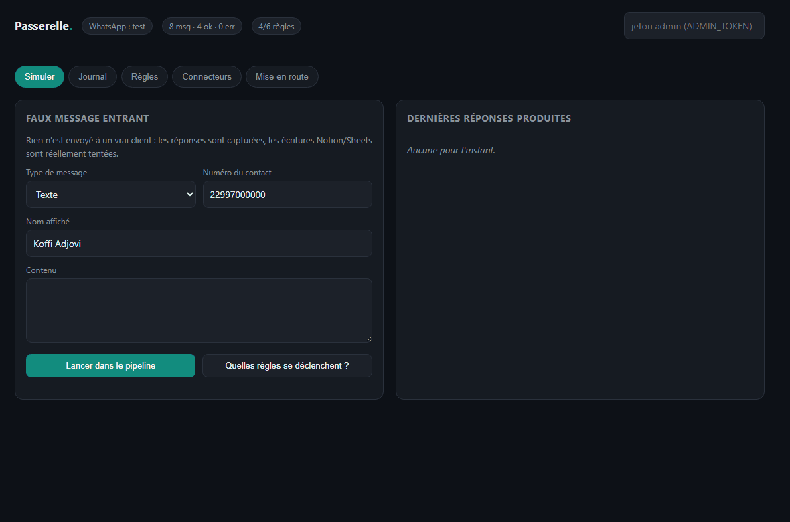
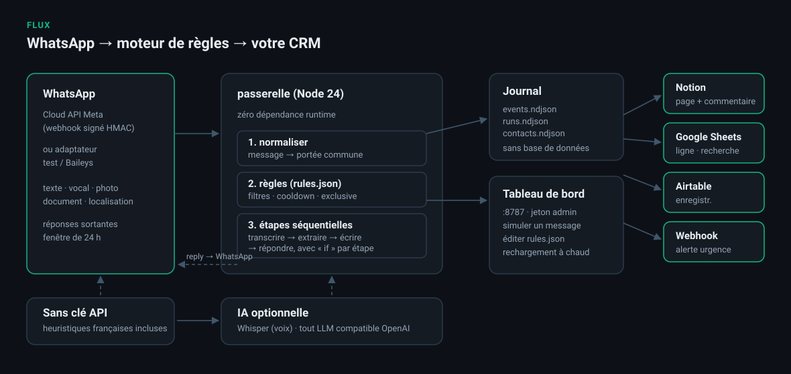
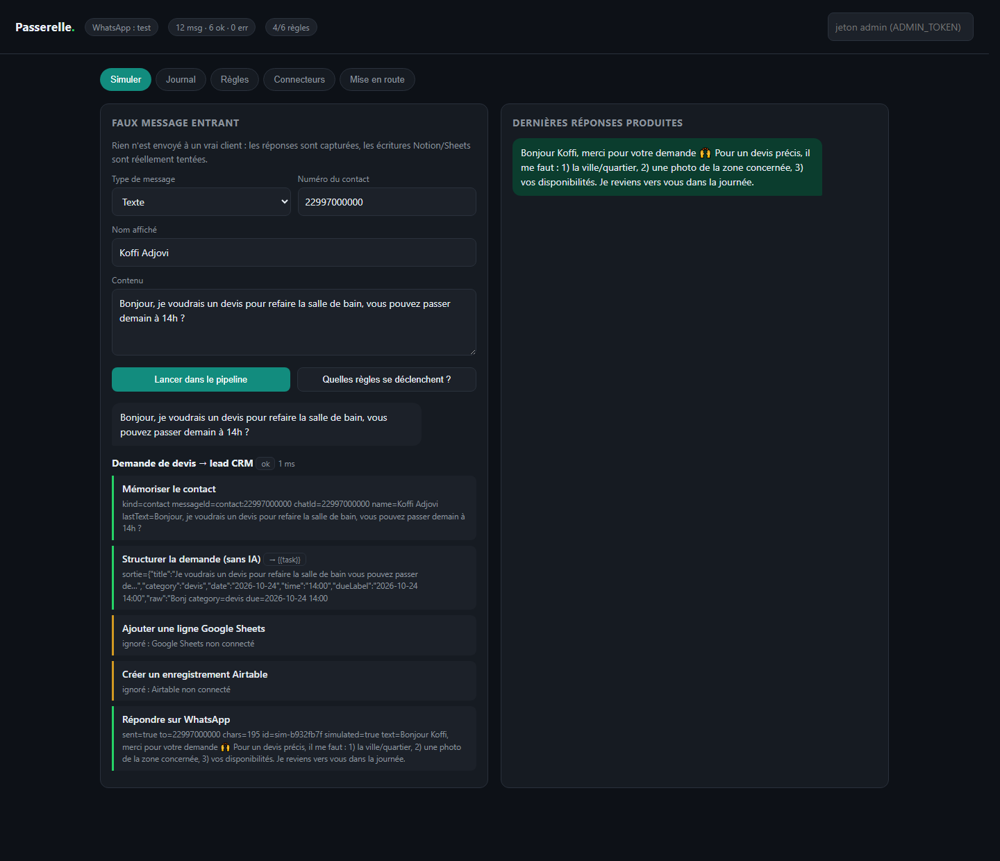
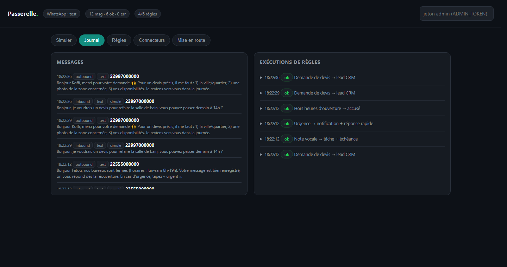
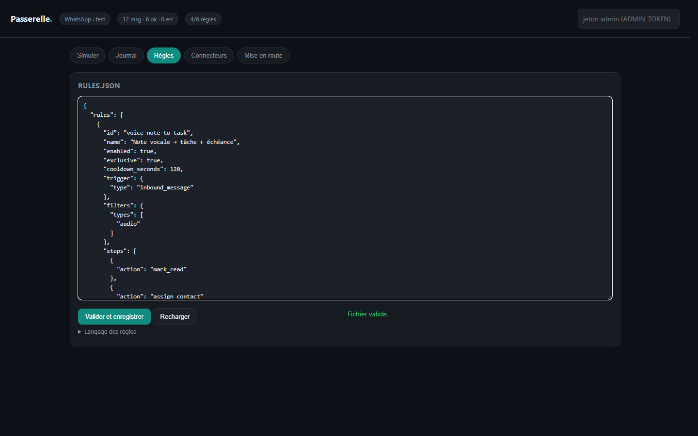
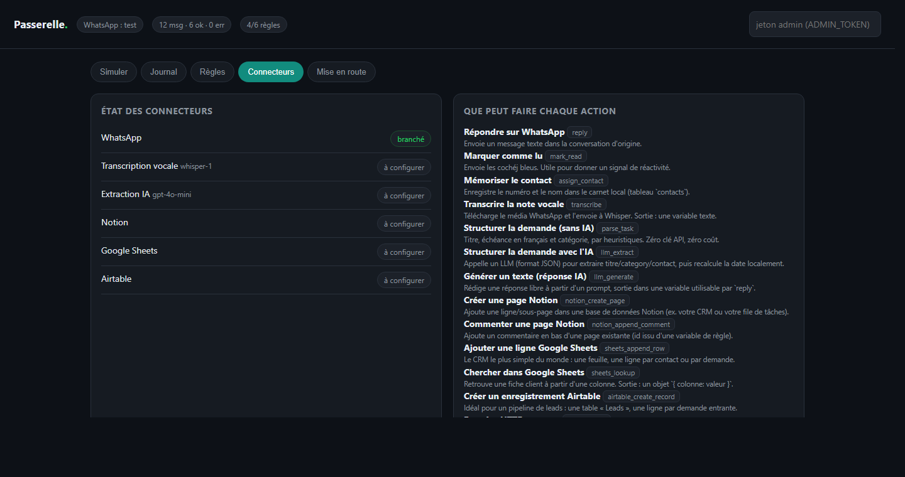
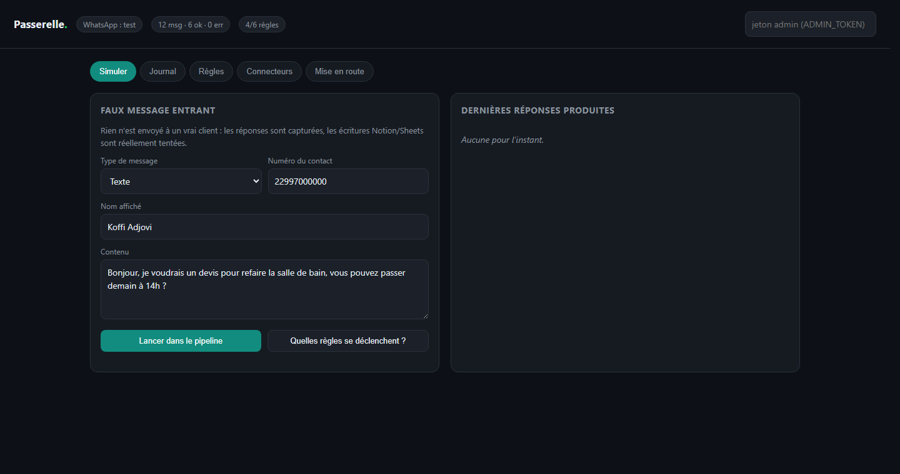

# Passerelle

**Le pont auto-hébergé entre WhatsApp et vos outils** — Notion, Google Sheets, Airtable, ou n'importe
quelle API. Un Zapier spécialisé sur la messagerie que vos clients utilisent vraiment, en un binaire
sans dépendances, sur le VPS de votre choix.

<p align="center">
  
  
  
  
  
</p>

<p align="center">
  
</p>

> État : **MVP prouvé bout en bout**. La chaîne complète (webhook WhatsApp → transcription vocale →
> extraction IA → Notion + Sheets → réponse client) tourne et est testée automatiquement contre des
> serveurs mock. Aucun composant n'est simulé côté moteur : ce qui passe au test passe en production,
> il ne manque que les credentials.

## Le trajet d'un message



Le GIF en tête de page joue cette scène sans aucun credential : le message entre, la règle
« Demande de devis → lead CRM » se déclenche, la réponse client sort. Le détail étape par
étape — `parse_task` qui calcule « demain à 14h » → `2026-10-24 14:00`, Notion / Sheets /
Airtable qui répondent « non connecté » au lieu de planter — est sur la capture juste après.
Rien n'est maquetté : toutes les images viennent de l'interface réelle (`node scripts/make-shots.cjs`).

<p align="center">
  
  <br><em>Une exécution étape par étape, avec le détail de chaque sortie.</em>
</p>

| Journal des messages et des exécutions | Éditeur de règles validé à la sauvegarde |
|---|---|
|  |  |

| État des connecteurs (ce qui est branché, ce qui manque) | Simuler sans jamais toucher un vrai client |
|---|---|
|  |  |


## Pourquoi c'est différent d'un SaaS à 89 €/mois

| | Passerelle | WATI / ManyChat / Zapier |
|---|---|---|
| Abonnement | 0 € (votre VPS) | 30 → 300 €/mois |
| Données clients | chez vous | chez l'éditeur |
| Marchés émergents | numéros +221 / +228 / +225 … | souvent ignorés |
| Transcription vocale | Whisper (OpenAI ou Groq) | supplément payant |
| Règles | fichier JSON versionnable, rechargé à chaud | interface cliquable, export payant |

## Démarrage en 30 secondes

Il faut **Node 24 ou plus récent**. C'est tout — `npm install` n'existe pas ici : zéro dépendance runtime.

```bash
node src/index.js
# → http://localhost:8787
```

Par défaut `WA_PROVIDER=test` : **aucun message réel ne part**. Ouvrez l'onglet **Simuler**, collez
« je voudrais un devis pour demain à 14h », lancez : vous verrez la règle partir, la date être
calculée, Notion et Sheets être sautés poliment (« non connecté »), et la réponse client s'afficher.

Pour alimenter le journal avec quatre cas métier réalistes :

```bash
node scripts/demo.js          # parle à un serveur déjà démarré
node scripts/simulate.js --voice --name="Awa Diop"   # pipeline complet, sans serveur HTTP
node scripts/simulate.js --explain "c'est urgent, j'ai une fuite"
```

## Ce que le moteur sait faire

```
WhatsApp (webhook Meta)            rules.json                 destinations
        │                                │
        ▼                                ▼
┌──────────────┐   normalisé   ┌──────────────────┐   étapes   ┌────────────────┐
│ CloudWhatsApp│──────────────▶│ Engine           │───────────▶│ Notion         │
│  · HMAC      │  {type, text, │  · filtres       │  séquentiel│ Google Sheets  │
│  · médias    │   contact,    │  · cooldown /contact│        │ Airtable       │
│  · retentages│   heure locale│  · exclusive     │            │ API générique  │
└──────────────┘   }           │  · idempotence   │            └────────────────┘
                               │  · journal NDJSON│                     │
                               └──────────────────┘◀──── réponses ──────┘
```

**Actions disponibles** (`GET /api/actions`, listées dans l'onglet Connecteurs) :

- `transcribe` — note vocale → texte (API compatible Whisper : OpenAI, Groq, ou serveur local)
- `llm_extract` / `parse_task` — titre, catégorie, échéance. `parse_task` marche **sans clé API**, il
  comprend « demain », « vendredi », « dans 3 jours », « le 12/11 », « fin de mois », « ce soir » en
  français. C'est le repli automatique quand l'IA échoue ou n'est pas configurée.
- `llm_generate` — réponse rédigée par IA
- `notion_create_page`, `notion_append_comment`
- `sheets_append_row`, `sheets_lookup` (compte de service, JWT signé en interne, pas d'OAuth interactif)
- `airtable_create_record`
- `reply`, `mark_read`, `assign_contact`, `http_request`, `set`

**Garde-fous intégrés** (les trois bugs qui ruinent une automatisation WhatsApp) :

1. **Idempotence** — Meta retente les webhooks ; un `wamid` déjà vu est ignoré.
2. **Cooldown par contact et par règle** — sinon une « réponse auto » boucle avec elle-même.
3. **`exclusive: true`** — la première règle qui traite un message empêche les autres de répondre aussi.

S'y ajoutent : signature HMAC `X-Hub-Signature-256` vérifiée, jeton admin en comparaison à temps
constant, corps de requête et médias bornés en taille, timeouts par étape, secrets masqués dans les logs.

## Écrire une règle

```jsonc
{
  "id": "voice-note-to-task",
  "name": "Note vocale → tâche + échéance",
  "exclusive": true,
  "cooldown_seconds": 120,
  "filters": { "types": ["audio"] },
  "steps": [
    { "action": "transcribe", "as": "transcript" },
    { "action": "llm_extract", "as": "task", "source": "{{transcript}}" },
    { "action": "notion_create_page", "title": "{{task.title}}",
      "date": { "Échéance": "{{task.date}}" },
      "text": { "Contact": "{{contactName}}" }, "continue_on_error": true },
    { "action": "reply", "if": { "path": "task.dueLabel", "op": "exists" },
      "template": "Bien noté {{firstName}} ✅ {{task.title}}, pour {{task.dueLabel}}." }
  ]
}
```

Filtres : `types`, `text_contains_any`, `text_contains_all`, `text_excludes_any`, `text_starts_with_any`,
`text_regex`, `min_chars`, `max_chars`, `from_country`, `fields` (ex. `{"isOutsideHours": true}`).
Conditions d'étape (`if`) : `exists` `is_empty` `equals` `not_equals` `contains` `starts_with` `in`
`gt` `gte` `lt` `regex`. Gabarits : `{{a.b}}`, `{{a.b ?? "défaut"}}`, `{{#a.b}}…{{/a.b}}`, `{{^a.b}}…{{/a.b}}`.
Comparaisons insensibles à la casse **et aux accents**.

Le fichier est relu toutes les 4 s : on édite, on sauvegarde, c'est en ligne. L'UI valide avant
d'écrire et refuse un document contenant une action inconnue ou un `id` dupliqué.

## Passer en vrai WhatsApp

1. [business.facebook.com](https://business.facebook.com) → créer une **app Meta** de type Business, activer le produit **WhatsApp**.
2. Récupérer `Phone number ID`, générer un **token permanent**, noter l'`App secret`.
3. `.env` : `WA_PROVIDER=cloud`, `WA_PHONE_NUMBER_ID`, `WA_ACCESS_TOKEN`, `WA_APP_SECRET`, `WA_VERIFY_TOKEN`, `ADMIN_TOKEN`.
4. Exposer le port en **HTTPS** (Caddy, Traefik, ou `cloudflared tunnel --url http://localhost:8787` pour tester sans ouvrir le serveur).
5. Meta → Configuration Webhook : URL `https://…/webhook/whatsapp`, champ d'abonnement `messages`.
6. Envoyer un message au numéro : il apparaît dans l'onglet Journal, en vrai cette fois.

**Ce que Meta impose, et qu'aucun pont ne peut contourner :** fenêtre de réponse de 24 h après un
message entrant, templates approuvés hors de cette fenêtre, vérification de l'entreprise pour
débloquer le volume, et facturation à la notification pour les messages sortants non sollicités
(depuis la refonte tarifaire d'octobre 2025 — vérifiez la grille en vigueur avant de promettre du
« gratuit » à un client). Les conversations initiées par le client restent le canal bon marché :
c'est exactement le cas d'usage d'un répondeur de PME locale.

## Et Baileys, alors ?

Baileys (WhatsApp Web non officiel) est la voie « gratuite et instantanée » : pas de vérification
d'entreprise, pas de templates, pas de facturation à la notification. Elle a trois prix :

- le numéro **peut être banni**, sans recours, pour usage automatisé non autorisé ;
- une mise à jour de WhatsApp casse le pont **sans préavis** ;
- pour une PME dont le numéro est le chiffre d'affaires, c'est un risque commercial, pas technique.

L'architecture est prête à l'accueillir : il suffit d'écrire une classe exposant
`sendText` / `downloadMedia` / `markAsRead` dans `src/wa/`, le moteur ne voit jamais le fournisseur.
Le point de travail réel est le QR de couplage à afficher dans l'UI et la session persistée chiffrée.
Choix assumé : **la Cloud API d'abord**, pour pouvoir vendre sans mettre en danger le numéro du client.

## Sécurité

- `ADMIN_TOKEN` obligatoire dès que la machine n'est pas en local : sans lui, l'UI est ouverte au réseau.
- Le webhook WhatsApp est le **seul** endpoint public ; il rejette toute signature invalide.
- `/api/simulate` ne peut **jamais** joindre un vrai client (messagerie d'enregistrement), `/api/send`
  est séparé volontairement pour qu'aucun clic distrait ne parle à un client.
- Les journaux NDJSON contiennent le texte des clients : `data/` est git-ignoré, à chiffrer au repos
  et à purger selon le RGPD (ou la loi locale sur les données personnelles).
- Les secrets ne sont jamais écrits dans `rules.json` : uniquement dans `.env`, et masqués dans les logs.

## Limites assumées de ce MVP

- Un seul numéro WhatsApp par instance ; pas de multi-tenant (l'argument payant, à venir).
- Pas de boutons/listes interactifs en sortie, ni de carrousels, ni de file de diffusion.
- Les images et documents entrants sont détectés mais pas encore exploités (OCR, devis photo).
- `sheets_lookup` charge la feuille entière : suffisant pour des centaines de lignes, pas des dizaines de milliers.
- Pas de tests d'intégration avec l'API Meta réelle (nécessite un numéro Business vérifié).
- Interface en français uniquement.

## Tests

```bash
npm test    # 16 tests, aucun réseau extérieur requis
```

`test/pipeline.test.js` monte un faux Meta, un faux Whisper, un faux Notion, un faux Google OAuth +
Sheets, puis envoie un vrai corps de webhook signé dans le vrai serveur HTTP. Il vérifie la signature
HMAC, le téléchargement du média, la transcription, la fusion LLM + calcul de date local, le payload
Notion, la ligne Sheets (et l'encodage `x-www-form-urlencoded` de l'échange OAuth), le message sortant,
l'idempotence sur retentage, le cooldown, et le fait qu'une simulation ne touche jamais l'endpoint
d'envoi réel.

## Régénérer les visuels du README

Les captures et le GIF viennent de l'interface réelle, pilotée par des paramètres d'URL
(`?chars=`, `?auto=1`, `#log`…) : pas de maquette redessinée à la main.

```bash
node src/index.js &                 # WA_PROVIDER=test par défaut
node scripts/demo.js                # 4 cas métier dans le journal
node scripts/make-shots.cjs         # docs/capture-*.png  (Chrome headless seul)
npm i --no-save pngjs gif-encoder-2 # dépendances hors dépôt, jamais publiées
node scripts/make-gif.cjs           # docs/demo.gif
```

`pngjs` et `gif-encoder-2` sont installés avec `--no-save` : ils ne touchent ni au
`package.json` ni au runtime. Le projet reste à zéro dépendance.

## Pistes de modèle économique

Le logiciel reste open source ; l'argent est dans le **pré-câblé par métier** et l'hébergement géré.

| Offre | Contenu | Prix indicatif |
|---|---|---|
| Self-hosted | ce dépôt, support communautaire | 0 € |
| Kit métier | templates (plombier, resto, cabinet, école, agent immobilier) + guide + mises à jour | 60–120 € une fois |
| Managé | instance chez vous ou chez nous, supervision, upgrades | 15–25 €/mois |
| Sur-mesure | règle spécifique, intégration CRM local, formation | 300 €+ |

En marché émergent, la marge n'est pas dans le SaaS mais dans l'installation chez le commerçant :
30 min de configuration, un numéro, un Notion, une réponse automatique qui ne se trompe pas.

## Licence

MIT — utilisez, modifiez, vendez l'accompagnement.
